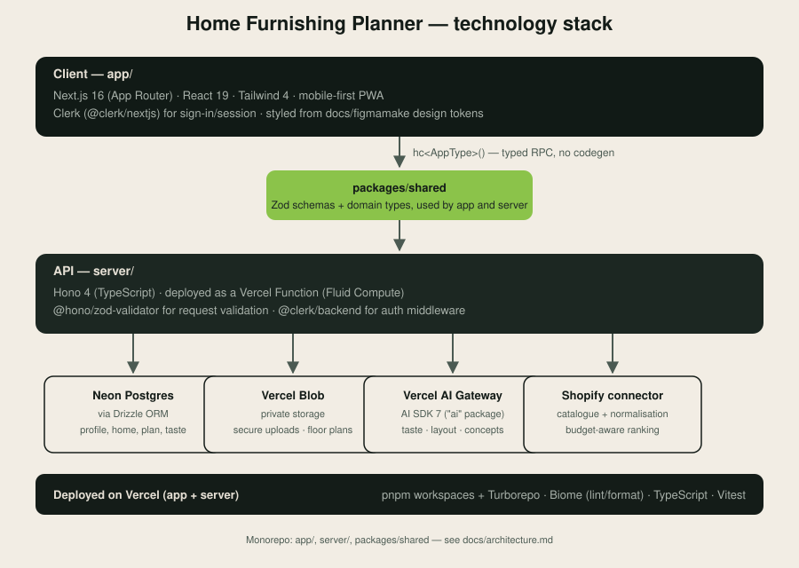

# Architecture



pnpm workspaces + Turborepo monorepo.

```
/
├─ app/                 Next.js App Router, TS, Tailwind — mobile-first PWA
├─ server/              Hono API, deployed as a Vercel Function
├─ packages/shared/     Zod schemas + types shared by app and server
├─ package.json         pnpm + turbo scripts: dev, build, lint, typecheck, test
├─ pnpm-workspace.yaml  app, server, packages/*
├─ turbo.json
├─ tsconfig.base.json
└─ biome.json
```

## app/

Next.js (App Router, TypeScript, Tailwind). The end-user UI for every journey
in the PRD, built mobile-first. Deployed on **Vercel**.

## server/

Hono API, deployed as a Vercel Function (Fluid Compute). Owns the
household/home/taste/plan/product/ledger domains and orchestrates AI calls,
uploads and connectors. Auth is `@clerk/backend` middleware; persistence is
Drizzle ORM over Neon serverless Postgres; file storage is private Vercel
Blob; AI calls go through AI SDK 7 and the Vercel AI Gateway.

`server/` is kept independently deployable so later capabilities (upload
quarantine, sandboxed parsing, connectors) can scale, time out, and be
secured separately from the UI — this follows the PRD's upload-security
principle (every upload is untrusted until it passes defence-in-depth
validation and quarantine).

## packages/shared/

Zod schemas and domain types used by both `app/` and `server/` — e.g. the
`HealthResponseSchema` for `{ status, service, version, time }`.

## The app ↔ server contract

`server/src/index.ts` exports the Hono app instance as default (Vercel
zero-config Hono entry) and `export type AppType = typeof app`. `app/`
depends on `server` only as a type-only devDependency and calls
`hc<AppType>(SERVER_URL)` from `hono/client`. This gives end-to-end type
safety for routes and response shapes with no codegen step and no shared
OpenAPI document.

## Local dev

- `server`: `tsx watch src/dev.ts` on port 8787.
- `app`: `next dev` on port 3000, reading `SERVER_URL=http://localhost:8787`.
- Root `pnpm dev` runs both together via Turborepo.

See [Setup](SETUP.md) for full install/run instructions.

## Platform services

| Service | Used by |
|---|---|
| Neon Postgres (via Drizzle ORM) | household-profile, home-model, taste-profile, room-planning, visual-concepts, product-catalogue, budget |
| Clerk (`@clerk/nextjs`, `@clerk/backend`) | sign-in/session on `app/`, auth middleware on `server/` |
| Vercel Blob (private) | secure-uploads, home-model, floor-plan extraction |
| AI SDK 7 + Vercel AI Gateway | taste-profile, room-planning, visual-concepts |
| Shopify connector | product-catalogue ingestion and normalisation, budget-aware ranking |

Still open from the roadmap (`openspec.yaml`), not yet provisioned: Vercel
Sandbox (isolated upload parsing) and Vercel Queues (async extraction/
generation with progress states). See [Roadmap & changes](openspec/) for the
change that will add each.

## Deployment split

- **Vercel** (`stepchange5` project) builds and serves `app/` and `server/` —
  the actual product.
- **GitHub Pages** builds this docs site from `docs/` only. Nothing under
  `docs/` or `.github/` is imported by the Vercel build, and nothing from
  `app/`/`server/` is published here.
