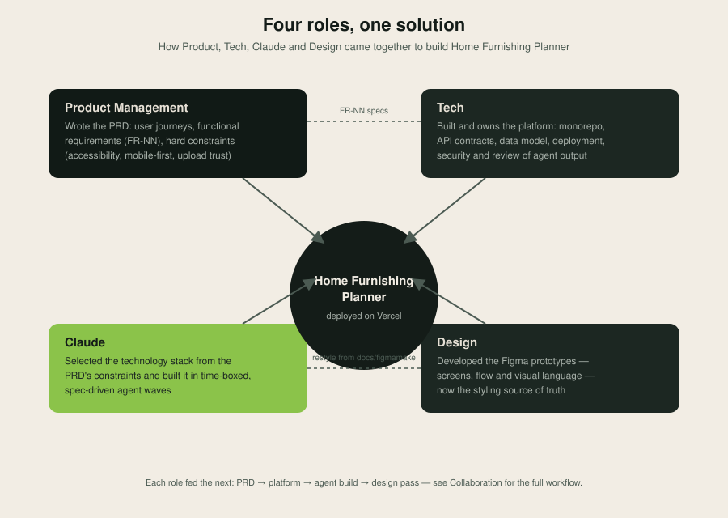
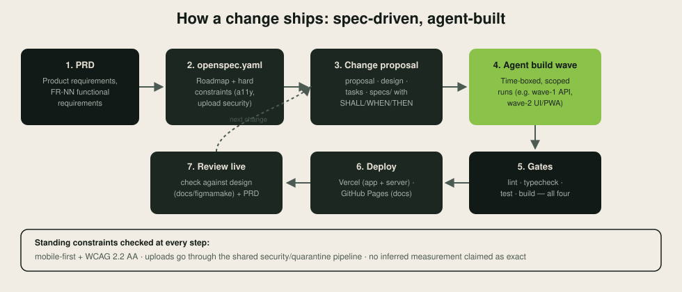

# How we collaborate

This page is the team manual: how a change goes from idea to merged code in
this repo. For environment setup see [Getting started](setup-repo.md) /
[Setup](SETUP.md); for the codebase layout see [Architecture](architecture.md).

## Four roles, one solution



- **Product Management** wrote the PRD — the user journeys, the `FR-NN`
  functional requirements, and the hard constraints (accessibility,
  mobile-first, upload trust) that every change is checked against.
- **Tech** built and owns the platform: the monorepo, the app↔server
  contract, the data model, deployment, and review of everything an agent
  produces before it's trusted.
- **Claude** selected the technology stack against the PRD's constraints
  (see [Architecture](architecture.md)) and built it through the spec-driven,
  time-boxed agent waves described below.
- **Design** developed the Figma prototypes (`docs/figmamake/`) — the screen
  flow and visual language the app was restyled against once they landed.

## The development process



## The roadmap drives the work

`openspec.yaml` at the repo root is the single source of truth for the
product roadmap: vision, hard constraints, architecture, data model, and the
ordered list of `changes` that implement it. Don't start new product work
without a line in there — see [Roadmap & changes](openspec/).

## Proposing a change: OpenSpec

Every non-trivial change (new capability, not a typo fix) gets an
`openspec/changes/<id>/` folder, driven by `openspec/config.yaml`'s rules:

- **`proposal.md`** — Why, What changes, which PRD functional requirement IDs
  (`FR-NN`) it implements or affects, the mobile-first/accessibility impact
  (state it even if "none"), and whether it touches file uploads (if so, it
  must reuse the shared upload-security pipeline, not a parallel path).
- **`design.md`** — the technical approach, for anything non-obvious.
- **`tasks.md`** — a checklist, ticked off as work lands.
- **`specs/<capability>/spec.md`** — requirements as `SHALL` statements with
  `WHEN`/`THEN` scenarios, each tied back to an `FR-NN`. Never describe an
  extracted or generated measurement as exact or verified unless the
  requirement explicitly says so.

See [`openspec/changes/bootstrap-platform`](openspec/bootstrap-platform/) for
a worked example of all four files.

## Building in agent waves

Once a proposal exists, implementation runs as scoped, time-boxed agent
builds rather than one open-ended effort:

- **Wave 1** built the server API surface — profile/household/accessibility,
  homes/rooms, secure uploads and floor-plan extraction, taste/brief/layout/
  concepts, and the Shopify catalogue and budget logic.
- **Wave 2** builds the app UI/PWA on top of that API, restyled against
  whatever is in `docs/figmamake/` at the time — design is picked up as the
  source of truth for visual styling, not guessed at ahead of time.

Each wave gets an explicit goal and time budget (e.g. "a click-through MVP of
the journey in 10 minutes") rather than a feature-completeness target, with
progress reported back at fixed intervals so scope can be redirected mid-run
instead of only at the end.

## Before opening a PR

From the repo root (pnpm + Turborepo):

```bash
pnpm lint
pnpm typecheck
pnpm test
pnpm build
```

All four must pass. Lint/format is [Biome](https://biomejs.dev/)
(`biome.json`) — run `pnpm lint` to check, most issues auto-fix.

## Accessibility and mobile-first are gates, not nice-to-haves

Per `openspec.yaml`'s hard constraints, every screen is designed and tested
mobile-first and must meet WCAG 2.2 AA — this applies across every capability,
not just a dedicated "accessibility feature". Check reflow at a 320px-wide
viewport with no horizontal scroll before calling a UI change done.

## Where things deploy

- **Product** (`app/`, `server/`) → **Vercel**, project `stepchange5`.
  `vercel deploy` from the repo; see [Setup](SETUP.md#deploy-product--vercel).
- **These docs** → **GitHub Pages**, built by
  [`.github/workflows/pages.yml`](https://github.com/dci-aloughran/stepchange5/blob/main/.github/workflows/pages.yml)
  from `docs/` on every push to `main`. Never point product env vars or
  secrets at anything under `docs/` or `.github/` — Pages content is public.
